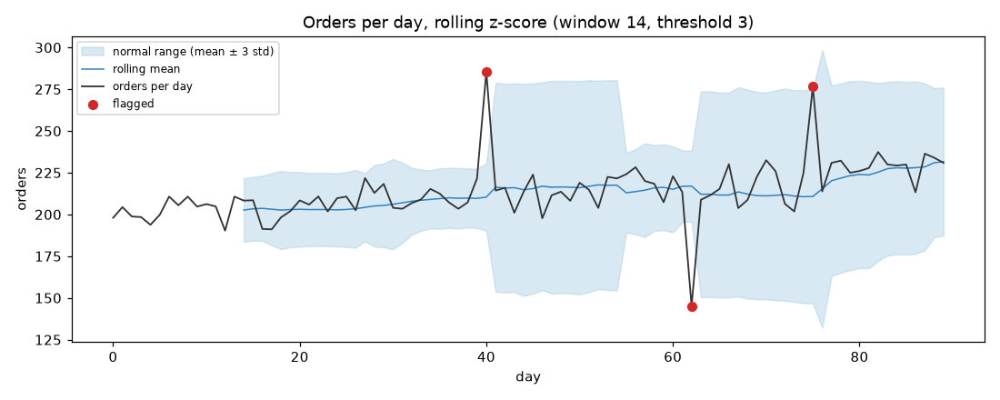

# Lab 11: rolling z-score anomaly detector, with a chart

**Result:** on 90 days of seeded shop orders with 3 injected incidents, a 14-day rolling z-score at threshold 3 catches all 3 with 0 false alarms (threshold 2 also catches all 3 but adds 2 false alarms); the third incident is caught only just (z = 3.1 instead of 6.2), because the incident before it is still inside the 14-day baseline and has widened the "normal" range.



## The problem

"Tell me when something looks wrong" is one of the first asks from any operations team: orders dropped, errors spiked, sign-ups vanished. A fixed rule ("alert below 150 orders") breaks as soon as the business grows. A rolling z-score compares each day with the recent past instead:

- **baseline:** the mean and standard deviation of the previous 14 days (never including today, or a spike would hide itself);
- **z-score:** how many standard deviations today is from that mean, `z = (today - mean) / std`;
- **alert:** when `|z|` is above a threshold, so both spikes and drops are caught.

## What this lab does

| File | Job |
| --- | --- |
| `detector.py` | `rolling_zscores` (warm-up period, flat-baseline guard, input checks), `flagged`, and `precision_recall`. Pure Python. |
| `data.py` | 90 days of orders, about 200 a day with a gentle trend and seeded noise, plus 3 incidents on known days: duplicate orders (day 40, +80), broken checkout (day 62, -70), bot orders (day 75, +60). |
| `chart.py` | Draws the series, the rolling mean, the shaded normal range (mean ± 3 std) and the flagged points to `chart.png`. |
| `demo.py` | Prints the table below and regenerates `chart.png`. |
| `test_detector.py` | 15 tests: z-score against a hand calculation, spikes and drops, warm-up, divide-by-zero, bad settings, the README table, the masking effect, and that the chart is a real PNG. |

`python demo.py` output (deterministic, the tests assert these rows):

| Threshold | Alerts | Incidents caught | False alarms | Precision | Recall |
| --- | --- | --- | --- | --- | --- |
| 2 | 5 | 3 of 3 | 2 | 60% | 100% |
| 2.5 | 4 | 3 of 3 | 1 | 75% | 100% |
| 3 | 3 | 3 of 3 | 0 | 100% | 100% |

Look at the chart after day 40 and day 62: the shaded band balloons for 14 days, because the incident itself is now part of the baseline. Day 75 lands inside the shadow of day 62, so its z-score falls from 6.2 (if day 62 had been normal) to 3.1. One more unit of noise and it would have been missed.

## Run it

```bash
pip install -r requirements.txt
pytest -q          # 15 tests, no network
python demo.py     # prints the table, writes chart.png
```

## Why it matters to a business

Every alert costs attention. Too sensitive (threshold 2) and the on-call person gets paged for nothing twice in three months and starts ignoring the pager; too lax and a broken checkout runs for a day before anyone notices. The threshold is a product decision about the cost of a missed incident versus the cost of a false alarm, and precision and recall on a few labelled incidents is how you make that decision with numbers instead of opinions. A chart with the normal range shaded is also what convinces a non-technical stakeholder that an alert was real.

## Trade-off

The rolling window is simple and adapts to growth, but it has two blind spots. First, masking: an incident stays in the baseline for 14 days and makes the detector deaf to the next one (the fix is to leave flagged days out of the baseline, at the cost of adapting more slowly to a real, permanent change). Second, a genuine step change, such as a price cut that lifts orders for good, is flagged as an anomaly for a few days until the window catches up. It also assumes no weekly pattern; a shop that is always quiet on Sundays needs a same-weekday baseline or seasonal decomposition. The data is synthetic so the incidents are known; on real data the labels have to come from incident reports.
